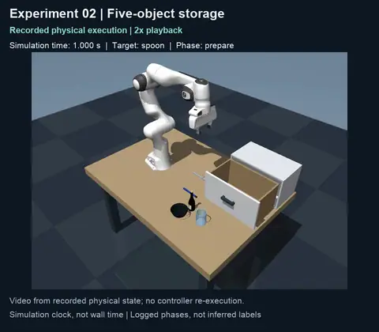

# Intelligent Grasping — Course Project

A lightweight, reproducible machine-learning foundation for predicting whether a simulated Panda grasp will succeed. This repository supplies a frozen CSV, shared evaluation rules, and one Logistic Regression reference baseline. Training remains CSV-only; the recorded demonstration below links to the separate live simulation runtime.

## Simulation demo



[Full English video (MP4)](media/experiment-02-five-object-storage-en.mp4) · [Recording source and hashes](media/manifest.json) · [Run the live simulator](https://github.com/youseihuayu-wonderful/Intelligent-Grasping-Predicting-Success-and-Selecting-Approach-Speeds-of-Robotic-Arms/blob/simulation-delivery-v1/docs/SIMULATIONS.md)

The animation loops through the complete recorded Experiment 2 mission. It uses a fixed controller, not the classifier baseline. Playback is 2×, not physical acceleration. GitHub displays a recording, not live MuJoCo.

## Start here

- **[Download the raw v1 CSV](https://raw.githubusercontent.com/youseihuayu-wonderful/intelligent-grasping-course-project/main/data/v1/dataset.csv)** · [Browse the data](data/v1/dataset.csv) · [Frozen manifest](data/v1/manifest.json)
- [Dataset, feature units, physical labels, and provenance](docs/DATASET.md)
- [Team roles, leakage prevention, metrics, and attribution rules](docs/TEAM_PROTOCOL.md)
- **[Both original simulations: Experiment 1 and Experiment 2](https://github.com/youseihuayu-wonderful/Intelligent-Grasping-Predicting-Success-and-Selecting-Approach-Speeds-of-Robotic-Arms/blob/main/docs/SIMULATIONS.md)** — runnable code, assets and authoritative execution evidence remain upstream; this repository mirrors the recorded Experiment 2 demo above.

## Install, validate, and run

Install [uv](https://docs.astral.sh/uv/getting-started/installation/), then run:

```sh
git clone https://github.com/youseihuayu-wonderful/intelligent-grasping-course-project.git
cd intelligent-grasping-course-project
uv sync --locked
uv run --locked python baseline.py --validate-only
uv run --locked python baseline.py --output results/logistic_baseline_v1_local
```

The lockfile specifies Python 3.12 and the baseline's NumPy/scikit-learn/SciPy/joblib dependencies. No MuJoCo, simulator assets, pandas, XGBoost, API key, or cloud service is needed. Validation checks the frozen package without fitting, scoring, or creating an output directory. `--data-dir data/v1` can be supplied explicitly; the default resolves to this repository's `data/v1`.

**Every baseline output directory must be new.** Existing directories are refused, not overwritten. Choose another run name when repeating the command; keep the committed reference run separate from local experiments.

### What the reference baseline does

`baseline.py` uses only the 11 approved pre-grasp predictors. A pipeline learns categorical encoding and numeric scaling inside each training fold, then fits Logistic Regression. It searches `C = [0.1, 1.0, 10.0]` by negative log loss on the frozen three grouped training folds, refits the chosen pipeline on training rows only, and evaluates validation rows. A constant predictor using training success prevalence provides a second reference. The command neither scores nor exports predictions for test rows.

Reference artifacts are linked directly rather than transcribed into a second metric table:

| Artifact | Purpose |
| --- | --- |
| [results/logistic_baseline_v1/report.json](results/logistic_baseline_v1/report.json) | Actual CV selection, validation and constant-prior metrics, data hashes, software versions, protocol, and limitations |
| [results/logistic_baseline_v1/validation_predictions.csv](results/logistic_baseline_v1/validation_predictions.csv) | Row-level validation labels and probabilities |
| [results/logistic_baseline_v1/cv_results.csv](results/logistic_baseline_v1/cv_results.csv) | Candidate search results |
| [results/logistic_baseline_v1/model.joblib](results/logistic_baseline_v1/model.joblib) | Fitted preprocessing and classifier; load only trusted model files |

The shared prediction interface is `row_index,trial_id,group_id,split,success,p_success,predicted_success`. `p_success` means probability of class **1**; predict success when `p_success >= 0.5`, including ties. Required metrics include log loss, Brier score, ROC-AUC for success, balanced accuracy, failure-class-0 recall, and a labelled confusion matrix. See the [full metric contract](docs/TEAM_PROTOCOL.md#shared-evaluation-contract).

## Frozen data and its limits

Version **v1** is an unchanged copy of upstream `results/grasp_classifier_five_objects_20261121/dataset.csv` at commit [`7a2c5642113d0d3b9c5b5d5205feda843b2c043a`](https://github.com/youseihuayu-wonderful/Intelligent-Grasping-Predicting-Success-and-Selecting-Approach-Speeds-of-Robotic-Arms/tree/7a2c5642113d0d3b9c5b5d5205feda843b2c043a). Its SHA-256 is `d218aca702d21fcd0bfe55d60b8022939e732a33c5cb81e42cf07f319716064a`.

There are **3,840 rows, 240 condition groups, and five target families**: bowl, bottle, spoon, glass, and pen, with 768 rows each. Preserve the upstream row order, group identities, train/validation/test assignments, and CV folds. Labels describe individual **grasp-and-hold**, not completed drawer storage.

**The existing test partition has already been published and inspected. It is a historical reference, not an untouched final test.** Do not use it for tuning. This foundation reports training CV and validation only. A genuinely fresh final performance claim would require newly held-out conditions later; collecting them is not part of the current steps 1–3.

## How the simulations relate

The [upstream simulation guide](https://github.com/youseihuayu-wonderful/Intelligent-Grasping-Predicting-Success-and-Selecting-Approach-Speeds-of-Robotic-Arms/blob/main/docs/SIMULATIONS.md) separates:

1. **Experiment 1:** the first independent five-object grasp-and-hold baseline, with its own source and execution evidence.
2. **Experiment 2:** the recorded continuous five-object drawer-storage archive, [`experiment-02-five-object-storage`](https://github.com/youseihuayu-wonderful/Intelligent-Grasping-Predicting-Success-and-Selecting-Approach-Speeds-of-Robotic-Arms/tree/experiment-02-five-object-storage), at commit `7a2c5642113d0d3b9c5b5d5205feda843b2c043a`.

Experiment 2 is fixed-controller engineering evidence, not a new classifier-training batch, not execution driven by this baseline, and not evidence of 100% overall classifier success. Older two-object CSVs and their results are separate historical datasets, not Experiment 1 labels or additional v1 rows. Sharing MuJoCo, Panda, and object assets does not establish predictive generalization across different clutter, poses, or controllers. Recordings illustrate execution; labels come from physical evidence, never animation.

## Team workflow

1. Everyone validates the same frozen v1 package and reproduces the reference baseline before changing a method.
2. Agree on one feature list, fold manifest, prediction schema, metrics, and tuning budget. Fit all preprocessing and any feature selection on the current training fold only.
3. Proposed ownership: **A** data/shared evaluation; **B** Logistic Regression and fold-local LASSO selection; **C** Random Forest; **D** XGBoost. These are assignments, not claims that LASSO, Random Forest, or XGBoost have been implemented or run here.
4. Work in branches and review changes with run commands, dependency versions, data hashes, and actual validation artifacts. Never silently change shared data, splits, labels, or metrics.
5. Cite reused upstream code/results and disclose AI assistance and collaboration as required by the course. Existing implementations and outputs are references, not final student submissions.

Read [TEAM_PROTOCOL.md](docs/TEAM_PROTOCOL.md) before comparing models. In particular, the upstream squared-loss **LASSO selector followed by Logistic Regression** is not L1-penalized Logistic Regression, and LASSO regression outputs are not class probabilities.
